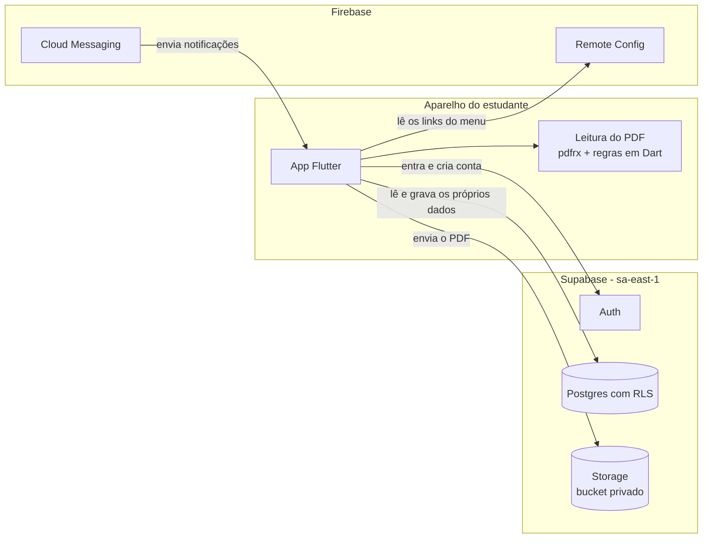
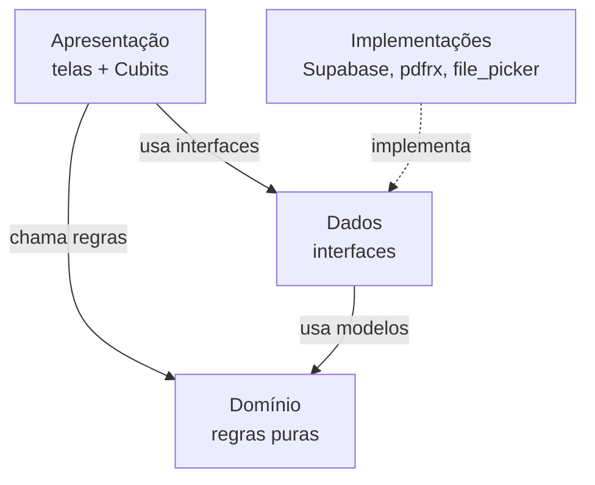
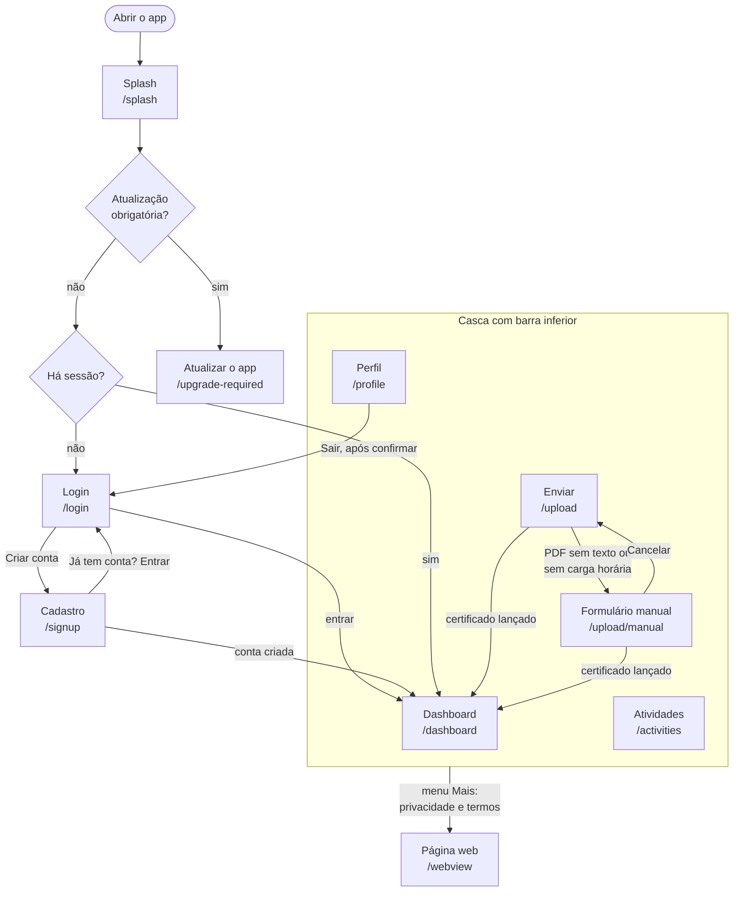
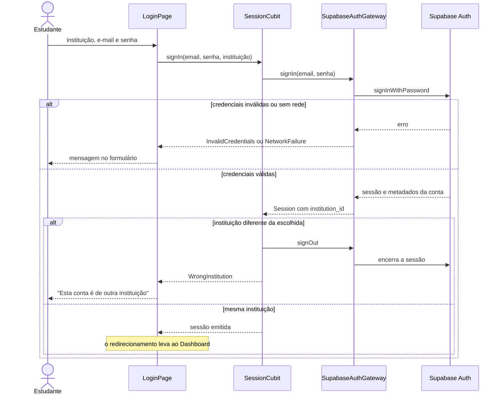
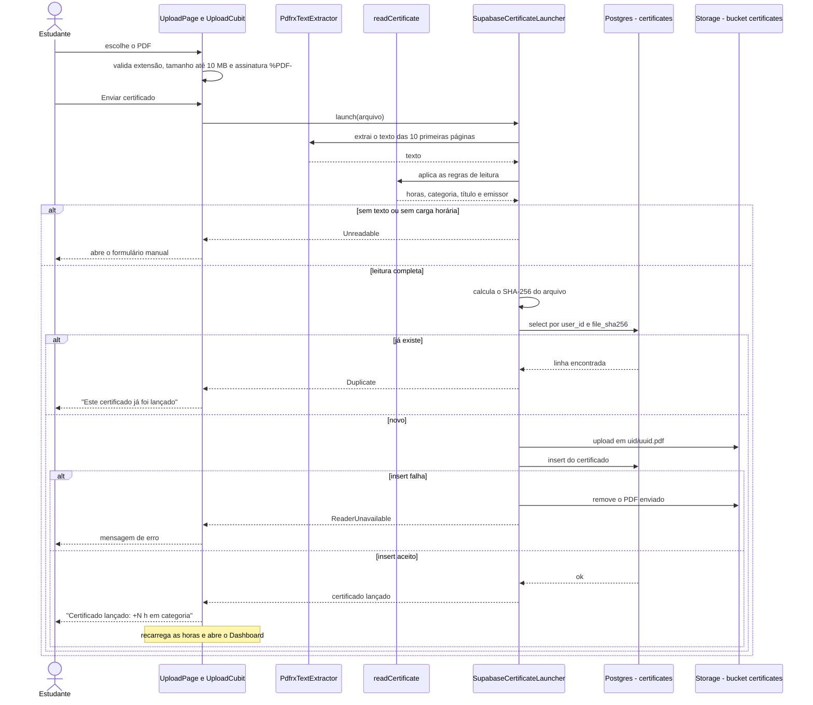

# 2. Arquitetura

Este documento apresenta a arquitetura do Uni Cronos: as camadas do aplicativo, a
navegação entre telas, a comunicação com o servidor e as bibliotecas usadas. A
descrição detalhada de cada módulo, com nomes de classes e regras, está em
[architecture.md](architecture.md).

## 2.1 Visão geral

O Uni Cronos é um aplicativo Flutter que se comunica diretamente com o
**Supabase**, um back-end gerenciado. Não há servidor próprio. O Supabase
fornece três serviços:

- **Auth:** contas com e-mail e senha e renovação da sessão;
- **Postgres:** as tabelas `profiles`, `certificates` e `opportunities`, todas
  protegidas por regras de acesso por linha (RLS);
- **Storage:** o bucket privado `certificates`, com uma pasta por estudante.

A leitura dos certificados acontece **no próprio aparelho**, com a biblioteca
`pdfrx` (baseada no PDFium) e regras escritas em Dart. O **Firebase** é usado
apenas para notificações push e para configuração remota (links de privacidade,
termos e compartilhamento).

## 2.2 Camadas

O código fica em `lib/` e é organizado por funcionalidade (`lib/features/`).
Cada funcionalidade é dividida em três camadas, e as dependências apontam sempre
para dentro: a apresentação depende do domínio, e os dados implementam
interfaces definidas junto ao domínio.

| Camada | Pasta | Responsabilidade |
|---|---|---|
| Apresentação | `presentation/` | Telas (widgets) e o estado de cada tela, em Cubits (`flutter_bloc`). Não acessa o Supabase diretamente. |
| Domínio | `domain/` | Regras puras, sem Flutter e sem rede: soma de horas e metas, leitura do texto do certificado, filtros do Hub, validações. |
| Dados | `data/` | Interfaces (por exemplo, `HoursRepository` e `CertificateLauncher`) e suas implementações com o Supabase, o `pdfrx` e o seletor de arquivos. |

Fora das funcionalidades:

- `lib/app/`: inicialização, injeção de dependências (`AppProviders`), rotas
  (`AppRouter`) e a casca com as quatro abas;
- `lib/core/`: tema e tokens de design, configuração, navegação, localização e
  utilitários compartilhados;
- `lib/l10n/`: os textos em português, inglês e espanhol.

Como o acesso a serviços externos fica atrás de interfaces, os testes
substituem cada uma por uma versão falsa. Isso permite testar telas e regras sem
rede, sem Supabase e sem Firebase.

## 2.3 Navegação

As rotas são definidas com `go_router`. Uma função de redirecionamento decide o
destino a partir de dois estados: se há sessão aberta e se a versão do
aplicativo está bloqueada por atualização obrigatória. As quatro abas ficam em
uma casca com barra inferior. Cada aba mantém o próprio estado ao trocar de aba.

Sem sessão, qualquer rota interna leva ao login. Com sessão, o login e o
cadastro levam ao Dashboard. O redirecionamento é reavaliado sempre que a sessão
muda: entrar leva ao Dashboard, e sair leva ao login.

## 2.4 Comunicação com o servidor

### Entrar na conta

O login confere, além da senha, se a conta pertence à instituição escolhida. A
instituição fica nos metadados da conta, gravados no cadastro.

### Lançar um certificado

O fluxo principal do aplicativo usa o Storage e o Postgres. O PDF é lido no
aparelho. Ao servidor vão apenas o arquivo e os dados já extraídos.

O banco reforça as regras no servidor, independentemente do aplicativo: horas
entre 1 e 999, um único certificado por estudante e SHA-256, e gravação
permitida apenas com o próprio `user_id`.

## 2.5 Dados

| Tabela ou bucket | Conteúdo | Quem lê | Quem grava |
|---|---|---|---|
| `profiles` | nome, instituição, curso, período | o próprio estudante | gatilho do banco, no cadastro |
| `certificates` | título, emissor, categoria, horas, caminho do arquivo, SHA-256, origem (lido ou manual), data | o próprio estudante | o próprio estudante; ninguém altera nem apaga |
| `opportunities` | cursos e eventos do Hub | estudantes autenticados, só os publicados | equipe, pelo painel |
| bucket `certificates` | os PDFs, até 10 MB cada | o estudante, na própria pasta | o estudante, na própria pasta |

As migrações ficam em `supabase/migrations/`, e os testes das regras de acesso,
em `supabase/tests/`.

## 2.6 Bibliotecas

Versões resolvidas em `pubspec.lock`.

| Biblioteca | Versão | Papel no aplicativo |
|---|---|---|
| Flutter / Dart | 3.41.5 / 3.11.3 | Framework de interface e linguagem. |
| `supabase_flutter` | 2.18.0 | Cliente do Supabase: Auth, Postgres e Storage. |
| `pdfrx` | 2.4.7 | Extração do texto do PDF no aparelho (PDFium). |
| `file_picker` | 11.0.3 | Seletor de arquivos do sistema para escolher o PDF. |
| `crypto` | 3.0.7 | SHA-256 do arquivo, para detectar duplicados. |
| `flutter_bloc` | 9.1.1 | Gerência de estado com Cubits. |
| `go_router` | 17.5.0 | Rotas, casca com abas e redirecionamento por sessão. |
| `shared_preferences` | 2.5.5 | Preferências salvas no aparelho (idioma, acessibilidade, notificações). |
| `intl` / `flutter_localizations` | 0.20.2 / SDK | Textos em pt, en e es e formatação. |
| `url_launcher` | 6.3.2 | Abre o link de inscrição no navegador do sistema. |
| `http` | 1.6.0 | Cliente HTTP usado pelo Supabase; nos testes, simula as respostas do servidor. |
| `firebase_core` | 4.9.0 | Inicialização do Firebase. |
| `firebase_messaging` | 16.2.2 | Recebimento de notificações push. |
| `flutter_local_notifications` | 19.5.0 | Exibição das notificações com o app aberto. |
| `firebase_remote_config` | 6.5.1 | Links de privacidade, termos e compartilhamento, sem nova versão do app. |
| `upgrader` | 13.4.0 | Aviso de atualização obrigatória. |
| `webview_flutter` | 4.13.1 | Exibe privacidade e termos dentro do app. |
| `package_info_plus` / `share_plus` | 9.0.1 / 11.1.0 | Versão do app no menu e compartilhamento do app. |
| `next_core_service` / `next_widgets_service` | 2.0.0 / 4.2.1 | Pacotes da BFAC: fábrica de tema, folhas de idioma e acessibilidade, filtro para daltonismo. |
| `flutter_lints` / `custom_lint` + `lints_service` | 5.0.0 / 0.8.1 / 1.2.0 | Análise estática e regras de lint do projeto. |

As fontes Montserrat e Inter ficam empacotadas em `assets/fonts/`, sob a licença
SIL OFL 1.1. Os ícones são os `Icons.*_outlined` do próprio Flutter.

## 2.7 Decisões de arquitetura

- **Back-end gerenciado em vez de servidor próprio.** O Supabase já oferece
  autenticação, banco relacional com RLS e armazenamento de arquivos. Isso
  reduz o que a equipe precisa manter.
- **Leitura do PDF no aparelho.** Dispensa um serviço de leitura no servidor, e o
  PDF não precisa ser processado fora do aparelho antes do lançamento. Como
  consequência, é o próprio app que grava o certificado: quem chamar a API
  diretamente consegue lançar horas sem um PDF real. Esse risco foi aceito para
  esta versão, e o banco limita os valores e guarda a origem de cada registro.
- **Serviços externos atrás de interfaces.** Permite testar o aplicativo inteiro
  sem rede, com versões falsas que também simulam falhas.
