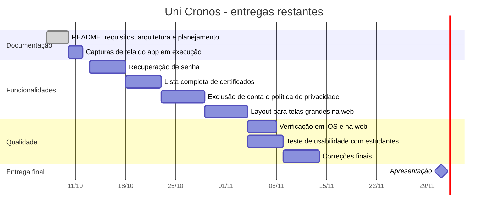
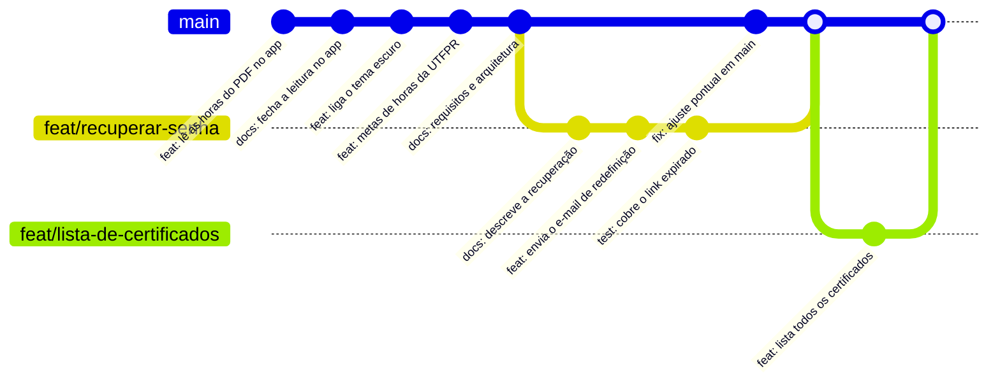

# 3. Planejamento

Este documento apresenta o cronograma das entregas restantes, a estratégia de
branches, a convenção de mensagens de commit e a justificativa da licença
adotada.

## 3.1 Cronograma das entregas restantes

O desenvolvimento começou em 16/09/2026. Até o início de outubro foram
entregues: design system, navegação, login e cadastro com Supabase, painel de
horas, envio e leitura de certificados no aparelho, Hub de Oportunidades,
Perfil, tema escuro e metas de horas da UTFPR. O cronograma abaixo cobre o que
falta até a entrega final. As datas são uma estimativa e podem ser ajustadas ao
calendário da disciplina.



| Entrega | O que inclui |
|---|---|
| Capturas de tela | Imagens do app em execução no Android, para substituir as do protótipo no README. |
| Recuperação de senha | O botão "Esqueci?" envia o e-mail de redefinição do Supabase Auth. |
| Lista completa de certificados | O botão "Ver todos" do Dashboard abre a lista de todos os certificados lançados. |
| Exclusão de conta e política de privacidade | O estudante pode excluir a própria conta e os PDFs enviados, e a política de privacidade fica publicada e acessível pelo menu. Completa o atendimento à LGPD. |
| Layout para telas grandes | Adaptação das telas para a web em computador. |
| Verificação em iOS e na web | Execução e conferência do app nas duas plataformas além do Android. |
| Teste de usabilidade | Sessões curtas com estudantes, usando certificados reais. |

## 3.2 Estratégia de branches

O projeto usa um modelo baseado em tronco (*trunk-based development*):

- `main` é a única branch permanente e precisa estar sempre estável. Todo
  commit que chega a ela passa na análise estática, nos lints do projeto, na
  formatação e em toda a suíte de testes.
- Mudanças pequenas e isoladas (um ajuste de texto, uma correção pontual) podem
  ser feitas diretamente em `main`.
- Uma funcionalidade nova é desenvolvida em uma branch de vida curta, criada a
  partir de `main`, com o prefixo do tipo de mudança: `feat/`, `fix/`, `docs/`.
  A branch volta para `main` quando a funcionalidade está completa e revisada
  por outro integrante da equipe, e é apagada em seguida.
- Não há branch `develop` nem branches de release.

Até esta entrega, o histórico foi linear em `main`, com commits pequenos. Para as
entregas restantes, em que mais de um integrante trabalha ao mesmo tempo, cada
funcionalidade passa a usar a própria branch curta. O diagrama ilustra o modelo
com commits reais de `main` e a próxima funcionalidade do cronograma.



## 3.3 Convenção de commits

As mensagens seguem o padrão [Conventional Commits](https://www.conventionalcommits.org/pt-br/v1.0.0/):

```
<tipo>: <descrição no presente, em português>
```

| Tipo | Uso | Exemplo do histórico |
|---|---|---|
| `feat` | Funcionalidade nova ou mudança visível ao usuário | `feat: lê as horas do PDF no próprio app e grava o certificado do aluno` |
| `fix` | Correção de defeito | `fix: dá ao título do card de horas a largura toda em telas estreitas` |
| `refactor` | Mudança interna sem alterar o comportamento | `refactor: leva a busca sem acentos para core/utils` |
| `test` | Testes sem mudança no código de produção | `test: prende horas e categoria a cada certificado e trava o arredondamento para baixo da meta` |
| `docs` | Documentação | `docs: documenta as metas de horas da UTFPR` |
| `style` | Formatação, sem mudança de lógica | — |
| `build` | Dependências e configuração de build | `build: adiciona pdfrx` |
| `chore` | Manutenção que não se encaixa nos outros tipos | `chore: coloca os ícones reais do app no Android e no iOS` |

Regras complementares:

- A descrição informa **o resultado entregue**, e não a lista de arquivos
  alterados.
- Cada commit trata de um único assunto. Funcionalidade, refatoração, correção e
  dependências não se misturam no mesmo commit.
- O commit que altera código inclui os testes correspondentes.

**Aderência no histórico:** todos os commits de `main` seguem a convenção, com
três exceções (96 de 99 commits em 07/10/2026, antes desta documentação): o commit inicial (`first commit`, 16/09), uma
atualização do README feita antes da adoção da convenção (29/09) e o commit
`...` de 07/10, que adicionou as imagens do protótipo em `assets/telas/`. Como os
três já estão publicados no repositório remoto, eles foram mantidos, e o
histórico não foi reescrito.

## 3.4 Licença

O projeto é distribuído sob a **licença MIT** (arquivo [LICENSE](../LICENSE)). A
escolha considerou:

- **Natureza acadêmica do trabalho.** A MIT permite que outros estudantes e
  instituições estudem, reutilizem e adaptem o código, inclusive para uso
  próprio, exigindo apenas a manutenção do aviso de copyright.
- **Compatibilidade com as dependências.** As principais bibliotecas do
  aplicativo usam licenças permissivas compatíveis com a MIT: `pdfrx`,
  `supabase_flutter` e `flutter_bloc` são MIT, e `go_router` e o próprio Flutter
  são BSD. Uma licença *copyleft*, como a GPL, exigiria distribuir sob a mesma
  licença o aplicativo compilado inteiro, incluindo os pacotes privados da BFAC
  dos quais ele depende, o que não é possível.
- **Simplicidade.** O texto é curto e amplamente conhecido, o que facilita o
  entendimento por quem avalia ou reutiliza o projeto.

A licença MIT cobre o código escrito pela equipe. As fontes Montserrat e Inter
mantêm a própria licença, SIL Open Font License 1.1, cujos textos estão em
`assets/fonts/`. Os pacotes `next_*` e `lints_service` pertencem à BFAC e não são
redistribuídos neste repositório.
